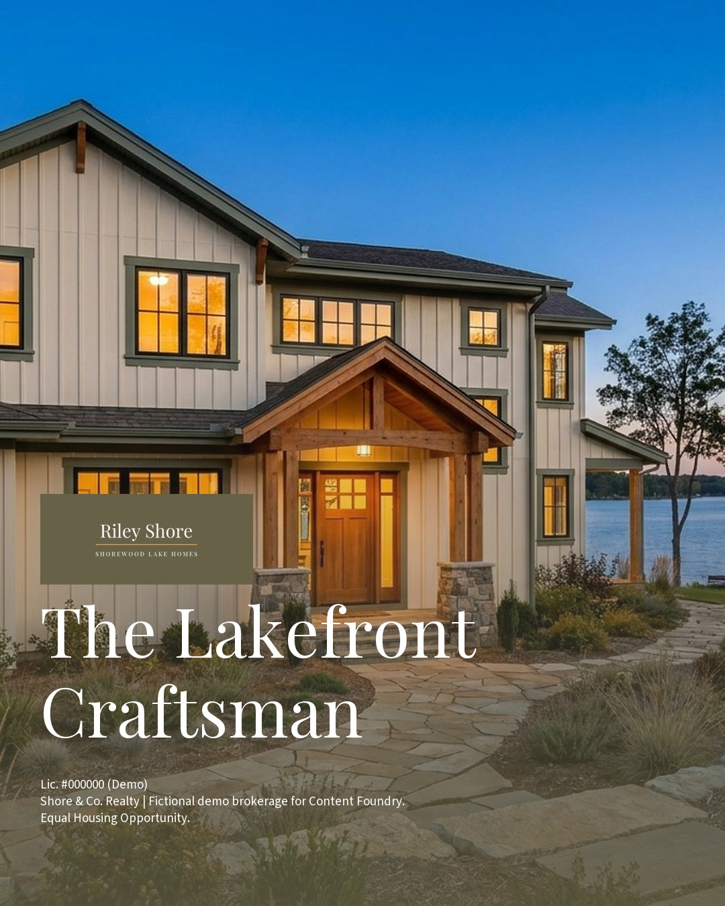
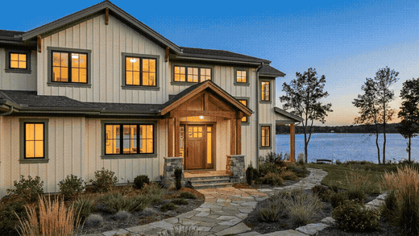

# Content Foundry

**A brand-locked, compliance-gated content engine for real estate — built as a Claude Code skill.**

Point it at one agent's brand folder, drop listing photos into a folder, ask for a job in plain
English — and get finished, channel-sized social assets: stills, a narrated video walkthrough, a
typography-led sales brief, a teaser cut, and an interactive scroll-through listing microsite.
Every asset carries the agent's real logo, exact brand colors, license number, and required
disclosures — **placed by deterministic scripts and verified by a lint that can actually fail**,
never left to a generative model's memory.

<p align="center">
  
</p>

<p align="center">
  <a href="docs/media/tour.gif"></a>
  <br/><em>The Interactive Scroll Tour: scroll-scrubbed camera flights through the listing's real
  photos, with doorway-portal transitions. <a href="#live-demo">Try the live demo →</a></em>
</p>

## Why this exists

Real estate agents fail at consistent content for a boring reason: the production pipeline —
gathering assets, remembering brand standards, resizing per platform, compliance lines, captions,
scheduling. Generic AI tools produce off-brand slop because they have no persistent brand context
and no quality gate. Content Foundry fixes both with three design rules:

1. **Composite, don't request.** The logo file's actual bytes, the exact brand hex, the license
   number, and the disclosure line are layered on by `composite.py` at channel-spec coordinates.
   A generative model is never asked to reproduce them.
2. **The lint must be able to fail.** `brand_lint.py` re-reads brand truth from disk and verifies
   the pixels — wrong hex fails, missing disclosure fails, sub-AA contrast fails. CI proves the
   failure paths stay wired.
3. **Foundation once, content forever.** Each agent is one portable folder (voice, colors, logo,
   compliance). A brokerage with 40 agents has 40 folders — tenancy is the filesystem.

## What it produces

| Product | Engine | Example |
|---|---|---|
| Channel stills (IG/FB/LinkedIn/Stories…) | Pillow composite + brand lint | `docs/media/gallery-*.jpg` |
| **Digital Walkthrough** — narrated room-by-room video | Remotion | `docs/media/walkthrough.gif` |
| **Digital Sales Brief** — typography-led 25s video | Remotion | — |
| **Listing Teaser** — 10s hook cut | Remotion | — |
| **Interactive Scroll Tour** — scroll-scrubbed listing microsite | scroll-world engine | [live demo](#live-demo) |
| Draft-first scheduling | Post Bridge CLI (optional) | — |

## Quickstart (5 minutes)

Requires [Claude Code](https://claude.com/claude-code). Then:

```bash
git clone https://github.com/BuildThingsThatBuildthings/content-foundry
cd content-foundry
python skill/content-foundry/scripts/doctor.py     # tells you exactly what to install
pip install -r skill/content-foundry/requirements.txt
cp -r skill/content-foundry ~/.claude/skills/content-foundry
```

Open Claude Code in the repo and try the bundled fictional demo:

> Run a new listing announcement for the agent in `demo/agents/riley-shore` using the photos in
> `demo/drop-lakehouse`.

It will inventory the drop, write a reviewable creative brief, composite branded stills for each
channel, lint them, and export. For video: `cd skill/content-foundry/engines/remotion && npm
install` once, then ask for a "digital walkthrough."

Setting up a **real** agent: say `set up my brand in Content Foundry` — a guided interview builds
the agent folder (see `skill/content-foundry/INSTALL.md` for the non-technical version).

## Architecture

```
drop folder ─→ 1 INGEST ─→ 2 UNIFY ─→ 3 RESEARCH ─→ 4 BRIEF ✋(review) ─→ 5 ROUTE
                                                                            │
              ┌─ stills (Pillow) ── 7 COMPOSITE ⚙ ── 8 LINT+QC ── 9 EXPORT ─┘
              ├─ Remotion video (Walkthrough / SalesBrief / Teaser)
              └─ Scroll Tour microsite (scroll-world engine)
                                              └──→ 10 PUBLISH (drafts only, optional)
```

Full details: [`docs/architecture.md`](docs/architecture.md) ·
[`skill/content-foundry/SKILL.md`](skill/content-foundry/SKILL.md) (the workflow itself)

Deterministic stages are Python scripts (stdlib + Pillow). Creative stages are the model's job.
The line between them is the product.

## Dependencies

| Tier | Needs | For |
|---|---|---|
| Core (stills) | Python 3.10+, Pillow | Everything in the stills pipeline |
| Video + tour | ffmpeg, Node 18+ (`npm install` in the engine, once) | Walkthrough/SalesBrief/Teaser, Scroll Tour |
| Optional | Post Bridge account + API key | Draft-first scheduling |
| BYO | Any TTS + music source (schema in `references/engine-remotion.md`), any image-gen API | Narration, music, generated base imagery |

`scripts/doctor.py` checks all of it with per-OS install hints.

## Honest roadmap

- **Image generation is bring-your-own.** The composite/lint pipeline consumes any base image
  file; a built-in generation call is not implemented yet. (The demo photos were generated with
  an external tool and are labeled fictional.)
- **Audio is bring-your-own TTS/music** via a documented json contract; no bundled voices.
- Windows is doctor-checked but less battle-tested than macOS/Linux — reports welcome.
- Roster/batch mode (one prompt across N agent folders) is specified, not yet built.

## Live demo

**[Watch the demo videos →](https://buildthingsthatbuildthings.github.io/content-foundry/)** —
the narrated Digital Walkthrough, the Sales Brief, and the Teaser, all generated by the pipeline
from one drop folder, plus the composited channel stills. The **[Interactive Scroll Tour](https://buildthingsthatbuildthings.github.io/content-foundry/tour/)**
(scroll room-to-room through doorway-portal transitions) is the bonus at the bottom.

To rebuild it yourself:
```bash
python skill/content-foundry/engines/scroll-tour/build_tour.py   --agent demo/agents/riley-shore   --scenes <your scenes.json> --out tour/
cd tour && python3 -m http.server 8000   # open http://localhost:8000
```

## Compliance disclaimer

Content Foundry enforces that required language (license number, brokerage disclosure, Fair
Housing line) is **present and legible** on every asset. The brokerage supplies the wording; the
skill never drafts or paraphrases legal text, and never auto-publishes. **This is assistive
tooling, not legal advice.** The prompt library additionally encodes Fair-Housing-aware copy
rules (describe the property, never the buyer).

## Demo media notice

Every property image in this repository depicts a **fictional home** and was AI-generated for
demonstration — because Content Foundry's own rules forbid generating imagery of real listings.
Riley Shore and Shore & Co. Realty are fictional.

## Credits

- [scroll-world](https://github.com/oso95/scroll-world) scrub engine by oso95 (MIT) powers the
  Interactive Scroll Tour.
- [Pretext](https://www.pretext.cool/) by Cheng Lou (MIT) computes deterministic text layout in
  the video engine.
- [Remotion](https://remotion.dev) renders the video products (note Remotion's own license terms
  for larger companies).
- Playfair Display & Source Sans 3 fonts, SIL OFL 1.1.

## License

MIT — see [LICENSE](LICENSE) and [NOTICE](NOTICE).
